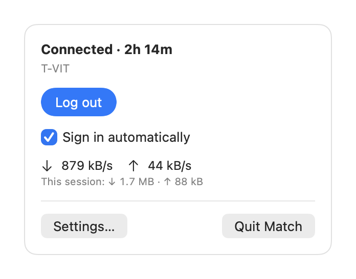
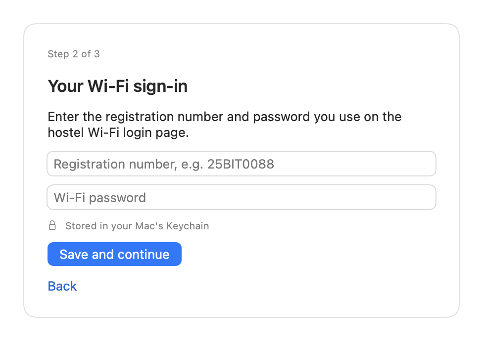
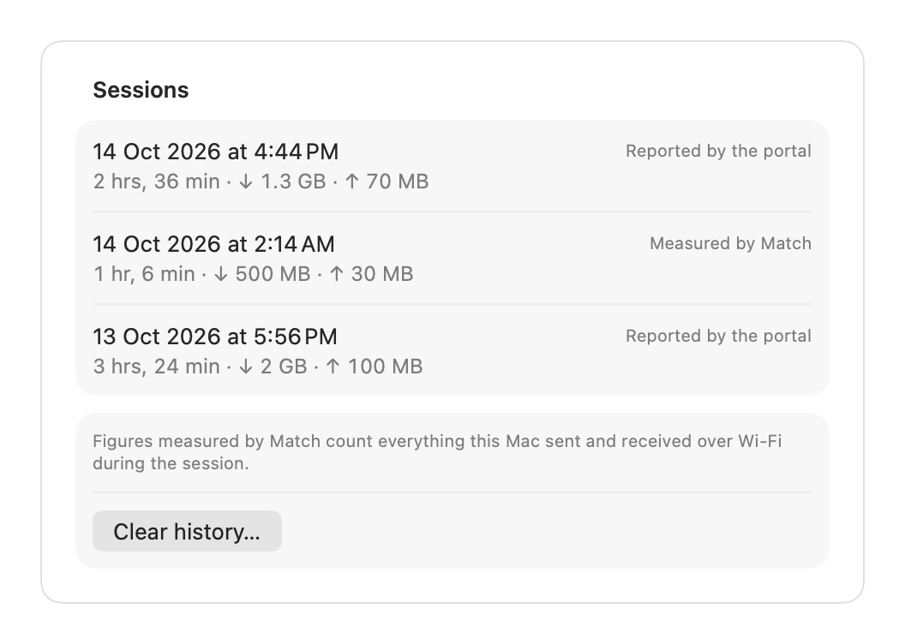

<p align="center"></p>

<h1 align="center">Match</h1>

<p align="center">
  <a href="https://github.com/dhruvrungta/match/actions/workflows/ci.yml"></a>
  <a href="https://github.com/dhruvrungta/match/releases/latest"></a>
  
  <a href="LICENSE"></a>
</p>

Match is a macOS menu-bar app that signs you in to the VIT hostel Wi-Fi automatically. It notices the Pronto Networks login page, signs in with the registration number and password you saved once, and signs in again when your session runs out. You stop seeing the login page.

It needs macOS 14 Sonoma or later, and runs on both Apple silicon and Intel Macs.

<p align="center">
  
  
</p>

## Install

Open Terminal and paste:

```sh
curl -fsSL https://dhruvrungta.github.io/match/install.sh | bash
```

The script downloads the latest release, checks it against its published SHA-256, copies Match into your Applications folder and opens it. It does not use `sudo` and never asks for your Wi-Fi password.

### Installing by hand

If you would rather not run a script:

1. Download `Match-<version>.zip` from the [Releases page](https://github.com/dhruvrungta/match/releases).
2. Double-click the zip to unpack it, and move **Match** into your **Applications** folder.
3. Open Match. macOS blocks it the first time, because it is not notarized (see [Why macOS warns about Match](#why-macos-warns-about-match)).
4. Open **System Settings → Privacy & Security**, scroll down to the message about Match, and click **Open Anyway**. Confirm when asked.

<!-- Screenshot placeholder: the "Match was blocked" message in Privacy & Security. -->
<!-- Screenshot placeholder: the Open Anyway confirmation. -->

If you are comfortable with Terminal, this does the same as steps 3 and 4:

```sh
xattr -dr com.apple.quarantine /Applications/Match.app
```

### Checking the download

Each release comes with a `.sha256` file. To check a zip you downloaded by hand, run this in the folder that holds both files. It should print `OK`:

```sh
shasum -a 256 -c Match-<version>.zip.sha256
```

## First run

A welcome window asks for your registration number (for example `25BIT0088`) and your Wi-Fi password, then offers to open Match when you log in to your Mac and to send notifications. After that, Match lives in the menu bar as a Wi-Fi icon:

| Icon | Meaning |
|---|---|
| Wi-Fi | Signed in |
| Wi-Fi, pulsing | Checking or signing in |
| Wi-Fi, dimmed | Online, but not on VIT Wi-Fi |
| Wi-Fi with an exclamation mark | Something needs your attention; click it |
| Wi-Fi with a slash | Not connected to Wi-Fi |


Two tips:

- **Set Private Wi-Fi Address to Fixed.** In System Settings → Wi-Fi → Details for the hostel network, set Private Wi-Fi Address to Fixed. The portal counts each address as a separate device, so a rotating address uses up your device limit.
- **macOS may show its own login window** for a moment when you join the network. It closes by itself once Match has signed you in.

## Usage figures

<p align="center"></p>

While you are connected, the menu shows the current download and upload speed and the data used since signing in. **Settings → History** lists past sessions. Figures marked "Reported by the portal" come from the portal's own sign-out page. Figures marked "Measured by Match" count everything your Mac sent and received over Wi-Fi during the session, so they can differ from what the portal counts.

## Updating

Match checks once a day whether a newer version exists, and shows "Match <version> is available" in its menu when one does. It never downloads or installs anything by itself. To update, run the install command again:

```sh
curl -fsSL https://dhruvrungta.github.io/match/install.sh | bash
```

You can switch the daily check off in **Settings → General**, and check by hand with **Check for Updates…** in the menu.

### Updating from a version before 0.2

Older versions kept your saved sign-in in a way that made macOS ask for approval after every update. The first time you open a newer version it shows "Match was updated" with an **Unlock** button. Click it, type your Mac's login password in the macOS dialog, and choose **Always Allow**. Match then moves the sign-in somewhere that updates don't disturb, and you are not asked again.

## Uninstalling

```sh
curl -fsSL https://dhruvrungta.github.io/match/install.sh | bash -s -- --uninstall
```

This asks for confirmation, then removes the app, its saved sign-in, its settings and its history. If macOS won't let the script remove something, it tells you what to delete by hand.

## Privacy

- Your registration number and password are stored in your Mac's Keychain, and nowhere else.
- They are sent only to the VIT login portal (`phc.prontonetworks.com`, or your Wi-Fi router's address when the portal's name can't be looked up), and only after the network has redirected Match to that portal.
- Match makes three other kinds of request, none of which carries any personal data:
  - a connectivity check to `clients3.google.com`;
  - once per Wi-Fi network, a request for your router's front page, to see whether it is a campus router;
  - once a day, a request for the latest version number from this project's GitHub Pages site. You can switch this one off.
- The session history holds only times and byte counts, and stays on your Mac.

**The portal only speaks plain HTTP.** Your password crosses the Wi-Fi unencrypted, exactly as it does when you type it into the portal's login page yourself. Match cannot change that. A hostile network that imitates the VIT portal could therefore capture the password. Match reduces the risk by signing in only when the network redirects to a known VIT portal address, but that check is not proof of the network's identity.

## Why macOS warns about Match

Apple only lets apps skip its warning if their developer pays for an Apple Developer account and has each release notarized. Match is free and is not notarized, so macOS treats it as coming from an unidentified developer.

Match is signed with a certificate of its own, which keeps its identity the same from one version to the next, but that certificate is not one Apple recognises. What you can do instead is check that a download is the one this project published, using the SHA-256 described above, and read the source code here.

## Building from source

You need Xcode 16 or later and [XcodeGen](https://github.com/yonaskolb/XcodeGen) (`brew install xcodegen`).

```sh
make build         # generate the Xcode project and build
make test          # run the unit tests
make run           # build and launch the app
make install       # copy the build to /Applications and launch it from there
make snapshots     # render every screen to build/snapshots
make test-mock     # end-to-end tests against a mock portal
make test-install  # test install.sh against a made-up release
make test-vault    # check the vault with the real signing certificate
make zip           # build the signed release zip, its SHA-256 and latest.json
make screenshots   # refresh the README's screenshots from the app's own screens
make icon          # redraw the app icon and the link-preview image
```

To try the app without the hostel network, run `make mock` in one terminal and `make run-mock` in another.

### Signing

Builds are signed with a self-signed certificate named "Match Self-Signed", so that the app keeps the same identity from one build to the next. Create it once:

```sh
tools/make_signing_cert.sh
```

Until that certificate exists, the Makefile signs ad-hoc and prints a warning. Tests are always signed ad-hoc and built separately, because macOS will not load a test bundle into an app signed with a self-signed certificate.

### The vault

macOS ties a saved password to the exact build of the program that saved it, and asks the user to approve any other build. To keep updates from triggering that, the password is not saved by Match itself but by a small helper inside it, the vault (`Vault/`), which is built and signed once and shipped unchanged in every release. It only answers a copy of Match signed with the project's certificate.

`Vault/MatchVault.xpc` is committed as a binary on purpose. **Don't rebuild it** unless the vault itself has to change: `tools/build_vault.sh` produces what the Keychain sees as a different program, and everyone who updates past that point is asked to approve once more. An ad-hoc build can't use the vault and falls back to saving the password itself. `make test-vault` checks the vault with the real certificate.

If you fork Match and sign with your own certificate, run `tools/build_vault.sh` once so the vault answers your builds.

### Making a release

One-time setup on GitHub:

1. Add two repository secrets, both printed by `tools/make_signing_cert.sh`: `SIGNING_CERT_P12` and `SIGNING_CERT_PASSWORD`.
2. In the repository's **Settings → Pages**, set the source to **GitHub Actions**.

Then, for each release, add an entry for the version to `CHANGELOG.md`, commit it, and push a tag such as `v1.2.0`. The release fails if the changelog has no entry for it. The release workflow tests, builds, signs and verifies the app, publishes a GitHub Release with the zip and its checksum, and publishes `latest.json` and `install.sh` to GitHub Pages. The first line of the tag's message becomes the short note shown in the app.

## Contributing

Bug reports and improvements are welcome; see [CONTRIBUTING.md](CONTRIBUTING.md). What changed in each version is in [CHANGELOG.md](CHANGELOG.md). Please report security problems privately, as described in [SECURITY.md](SECURITY.md).

## License

MIT. See [LICENSE](LICENSE).
